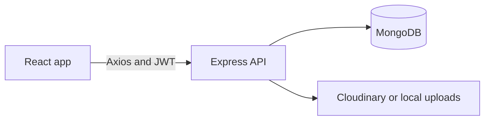

# Architecture

Garissa SportsConnect is two applications that share one database.

The React app in `client` renders the public site and six role dashboards. Vite proxies `/api` and `/uploads` to the API during development. Production builds call `VITE_API_URL`.

The API in `server/src` is organized as:

- `models.js` — one Mongoose schema per collection
- `routes` — auth, athletes, clubs, teams, tournaments, opportunities, performance, notifications, admin, and public platform routes
- `middleware.js` — JWT checks, role checks, validation, rate limits, and error handling
- `utils.js` — standings, round-robin fixtures, privacy serialization, and notifications
- `seed.js` — demo county data

A request is authenticated by a bearer token. The token stores the user id and a `tokenVersion`. Logout, password reset, and suspension increment that version, so older tokens stop working on the next request.

Authorization is checked again in each route. A coach can manage only their teams. A club admin can manage only their clubs. An organizer can score only their tournaments. Public reads never include draft competitions or unverified clubs.

## Privacy boundary

Age is calculated from date of birth. Under 18:

- registration requires guardian name, phone, and consent
- the profile cannot be set to public
- the public athlete directory and public squad lists omit the athlete
- scouts can see sport, position, and skills, not contact details, photos, or body measurements
- the coach or club admin of that athlete can see guardian contact

The app does not collect national ID numbers.

## Standings

Completed matches feed `computeStandings`. The table is calculated when a tournament is read, so a saved score updates the league without a separate write.

## Deployment

`render.yaml` describes the API service. `client/vercel.json` keeps client-side routes on one index file. Production must set `MONGO_URI` and `JWT_SECRET` and should be served over HTTPS.
