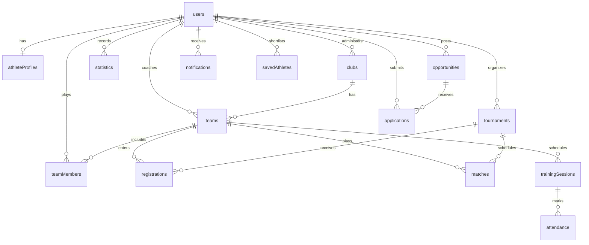

# Database

MongoDB database: `garissa_sportsconnect`.

Local development stores it at `%LOCALAPPDATA%\garissa-sportsconnect\mongo` so OneDrive does not lock the files. Production uses the `MONGO_URI` database, normally MongoDB Atlas.

| Collection | Stores |
| --- | --- |
| users | Account, role, phone, sub-county, date of birth, guardian consent, suspension, password reset, and token version. Passwords are bcrypt hashes and are not returned by queries. |
| athleteProfiles | Sport, position, skills, achievements, photos, visibility, discoverable flag, and whether the athlete is under 18. |
| clubs | Club record, contact details, and verification status: pending, verified, or rejected. |
| teams | Name, sport, club, coach, and home ground. |
| teamMembers | Player, jersey number, and captain or player role. Unique per team and athlete. |
| tournaments | Competition, format, dates, status, and organizer. |
| registrations | Team entry. Unique per tournament and team. |
| matches | Fixture, score, venue, round, and status. |
| statistics | Dated metric list for an athlete, such as goals or time in seconds. |
| trainingSessions | Team session title, time, and place. |
| attendance | Present, absent, late, or excused. Unique per session and athlete. |
| opportunities | Trial, scholarship, recruitment, or other post. |
| applications | One application per athlete per opportunity, with a status. |
| notifications | Title, message, link, and read flag. |
| savedAthletes | Scout shortlist and private note. Unique per scout and athlete. |
| reports | Moderation report. This supports the security requirement to report accounts and content. |

Indexes cover unique emails, athlete sport and visibility, team membership, tournament registration, applications, attendance, and shortlists.
